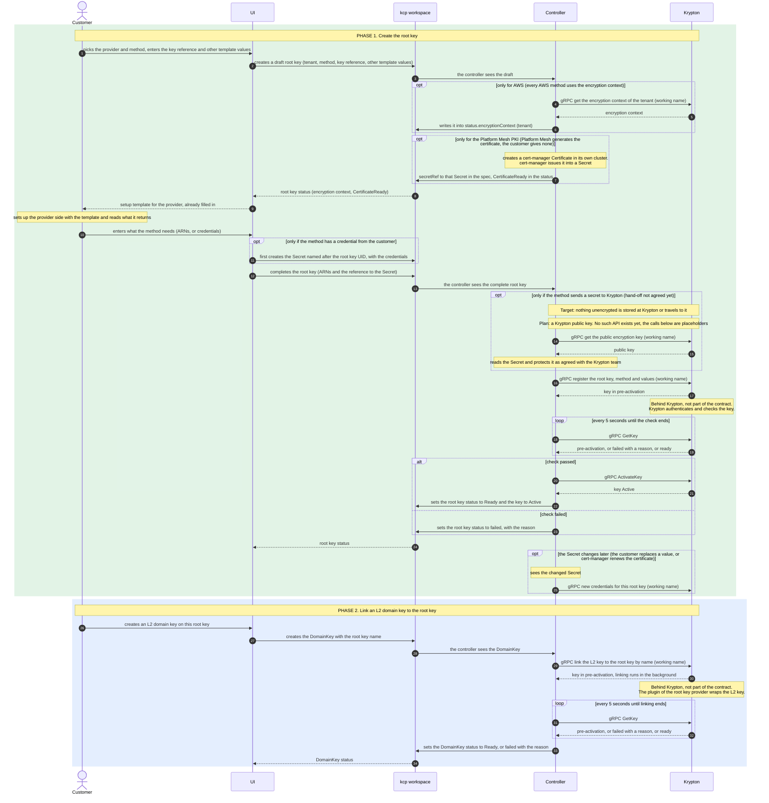
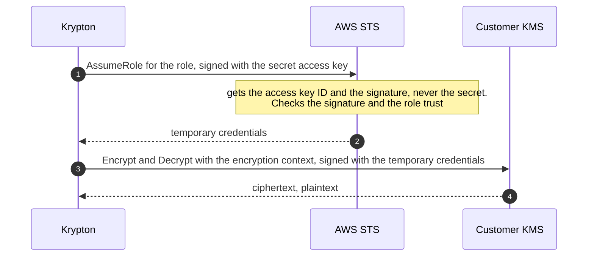
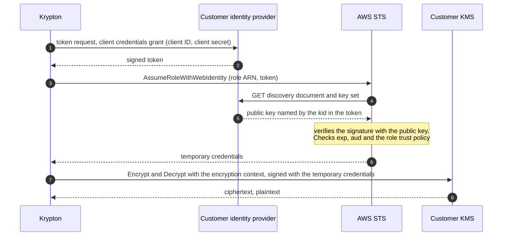
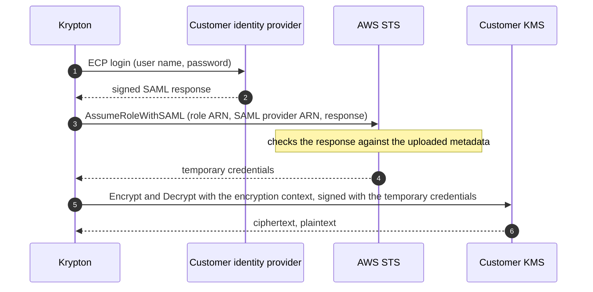
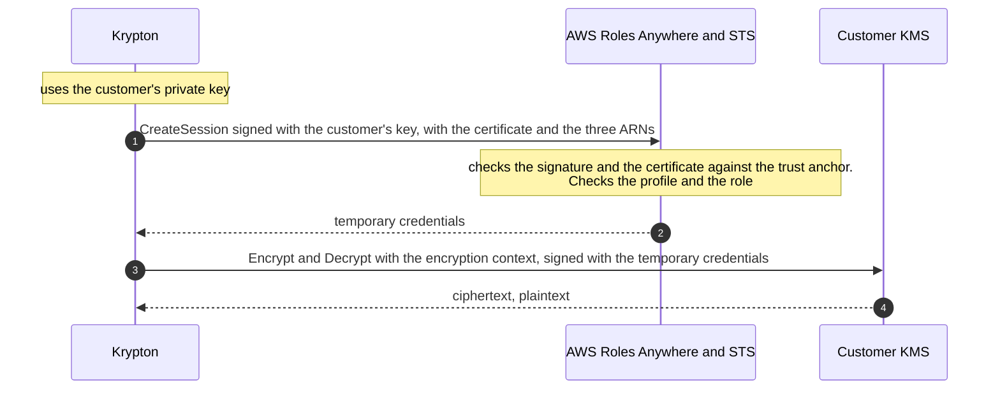
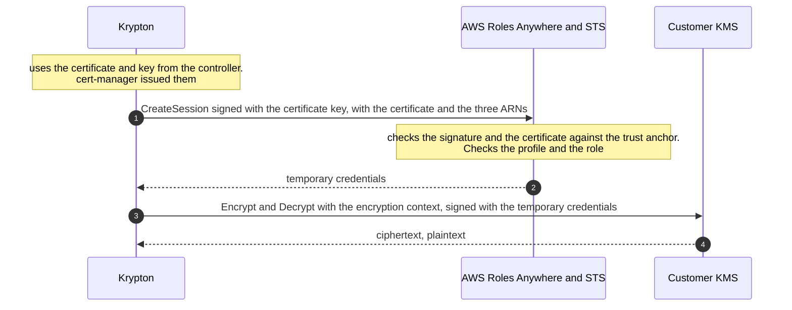

# Root keys: the generic flow

The first diagram applies to every provider and every authentication method. It has two phases: creating the root
key, and linking an L2 domain key to it. It stops at Krypton: the controller calls Krypton and follows up. Call
names marked "working name" are placeholders, the API is designed by the Krypton team.

The authentication methods and their fields are listed per provider:

- [AWS KMS](aws.md)
- [GCP Cloud KMS](gcp.md)
- [Azure Key Vault](azure.md)

The small diagrams at the end show how Krypton authenticates to AWS with each method. They are behind Krypton, so
they are examples only and not part of the contract.

## Generic flow

## What differs per AWS method

Every method also sends the method, the tenant ID, the KMS key ARN and the region in the register call. The
methods are described in [aws.md](aws.md).

| Kind | Variant | In the status | Customer enters after the template |
|---|---|---|---|
| 1. Static secret | A. Access key | encryption context | access key ID, secret, role ARN |
| 2. Identity provider | A. Customer's IdP | encryption context | role ARN, token endpoint, client ID, client secret |
| | B. Customer's SAML identity provider (after OIDC) | encryption context | 2 ARNs, user name, password |
| 3. Certificate | A. Customer's certificate | encryption context | 3 ARNs, certificate, private key |
| | B. Platform Mesh PKI | encryption context, CertificateReady | 3 ARNs |

The methods that send a secret to Krypton (static secret, identity provider A and B, certificates A and B) use the
hand-off `opt` block of the generic flow. How the secret reaches Krypton is not agreed yet.

For all of them except the Platform Mesh PKI, the credentials stay in a Kubernetes Secret in the customer's
workspace. The UI creates it before it completes the root key, and the AWSRootKey only references it. For the
Platform Mesh PKI, cert-manager creates the Secret in the controller's cluster, and the AWSRootKey references it in
the spec.

## How Krypton authenticates to AWS, per method (examples)

Each diagram starts when Krypton has received the register call and ends when it can use the key.

### 1. Static secret

#### A. Access key

### 2. Identity provider

#### A. Customer's identity provider

#### B. Customer's SAML identity provider

### 3. Certificate

#### A. Customer's certificate

#### B. Platform Mesh PKI

